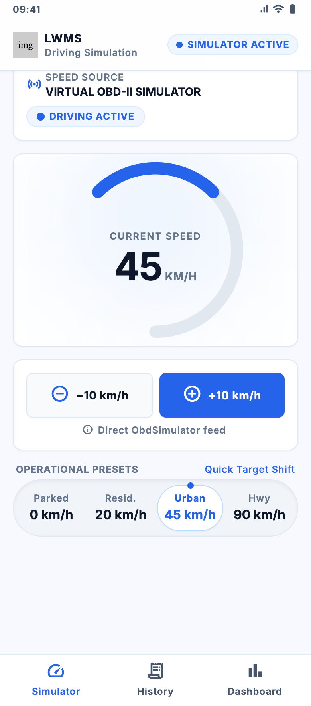
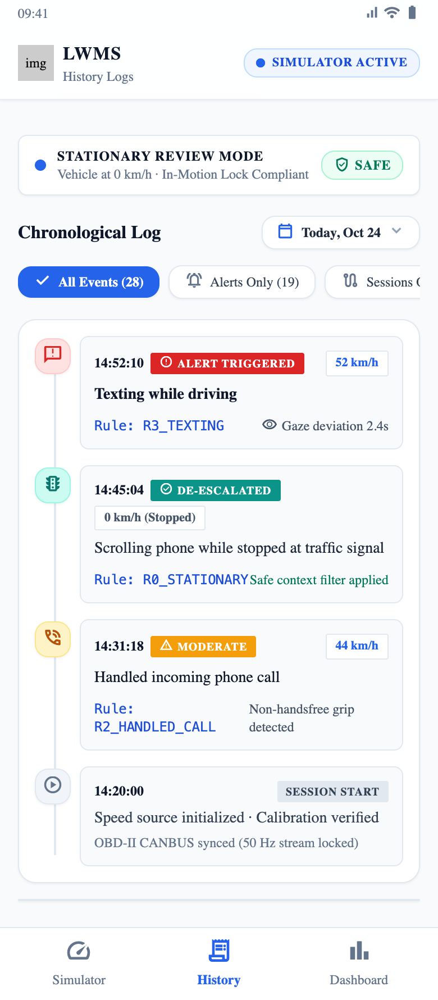
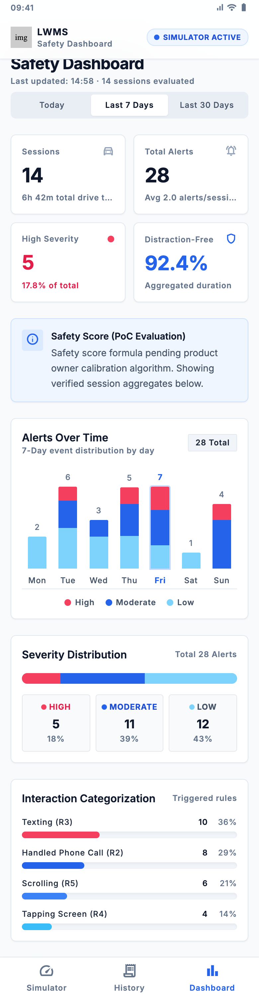

# DriveSafe (LWMS: Lightweight Multimodal System)

DriveSafe is an advanced, camera-free, on-device Android application designed to detect driver distraction (texting, scrolling, tapping, calling) and grade its severity (**Low / Moderate / High**) using a deterministic, expert-rule decision tree.

## Overview & Screenshots

| Simulator (Home) | History Logs | Safety Dashboard |
| :---: | :---: | :---: |
|  |  |  |

## Key Features
- **Deterministic 8-Layer Decision Tree**: Pure-Kotlin core logic evaluating speed, IMU motion, and app-level behavior without requiring cloud ML or training data.
- **Multimodal Telemetry & Data Streams**:
  - OBD-II speed via Bluetooth ELM327 or interactive Virtual OBD-II Simulator.
  - Phone IMU (accelerometer & gyroscope) for handling classification.
  - App-level behavior via Android AccessibilityService & TelephonyManager.
- **Precision Telemetry UI Kit**: 3 primary screens (Simulator, History, and Dashboard) linked via a bottom navigation bar, built with Jetpack Compose following the Precision Telemetry Light design system.
- **Persistent Room Database**: Local SQLite persistence ensuring logs and driving sessions remain stored across app restarts.
- **Instant Severity-Mapped Notifications**: Real-time notifications mapped precisely to risk levels (Low = muted, Moderate = bip, High = high alert with sound, vibration, and TTS).

## Architecture
- **`logic/`**: Pure-Kotlin decision tree, hysteresis state machine, feature vector models, and configuration defaults.
- **`features/`**: Feature extraction and z-normalized phone-handled classification.
- **`sensor/`**: OBD-II simulator and telemetry data sources.
- **`data/`**: Room database entities, DAOs, converters, and persistent event repository.
- **`service/`**: Foreground monitoring service and accessibility event listeners.
- **`ui/`**: Jetpack Compose screens (Dashboard, History, Simulator, Splash).

## Research Paper & Specifications
- **Source Material**: [Progress Report v2.pdf](Ressources/Progress%20Report%20v2.pdf) (Based on *Progress Report #2, "Proposed DT Approach", RIF Grant 23081, Aug 2026*).

## How to Use
1. Clone the repository and open in Android Studio (Giraffe or newer).
2. Grant notification permissions and enable the unified **DriveSafe** Accessibility Service in system settings.
3. Use the **Simulator** screen to adjust driving speed or connect to OBD-II, and test distraction interactions (texting, scrolling, tapping).
4. Monitor risk distribution, history logs, and session analytics in the **Dashboard** and **History** tabs.
